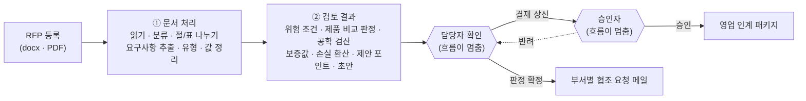

# Spec2Win — RFP 기술 검토 AI 에이전트

> 수백 쪽짜리 전력 설비 입찰 RFP에서 **지켜야 할 조건은 빠짐없이, 내세울 강점은 근거와 함께** 찾아 주는 기술 검토 지원 시스템입니다.
> "시스템이 찾고, 엔지니어가 정합니다."

> [!NOTE]
> SKKU × LS AI CAMPUS 1기 2조 최종 프로젝트(2026-10-16 ~ 11-10, 4인 팀)를 팀원 동의를 받아 개인 포트폴리오용으로 공개한 사본입니다. 고객 RFP 원문과 운영진 제공 데이터는 뺐습니다([data.md](docs/data.md)).
> 저는 **조장·PM, 오케스트레이터·판정·AI 추출**을 맡았고, 수료 뒤 이 사본에서 **혼자** 비동기 작업 대기열·LLM 품질 평가·AI 호출 관측·Langfuse 연동을 더했습니다.

## 무엇을 하나

입찰 기술 검토 엔지니어는 수백 쪽 RFP를 직접 읽고, 우리 제품이 요구를 맞추는지 판정하고, 일탈·질의 목록을 씁니다. 실제 RFP 22개를 분석해 보니 요구사항 후보가 약 11,540줄이었고, 같은 항목에 값이 다른 곳, 계산이 맞지 않는 숫자, 놓치면 계약 조건이 되는 조항이 숨어 있었습니다.

Spec2Win은 docx·PDF를 올리면 요구사항을 찾아 제품표와 비교 판정하고, 일탈·질의 초안, 보증값 후보, 손실 환산, 기술 제안 포인트, 부서별 협조 요청, 결재 뒤 영업 인계 패키지까지 **모두 원문 위치와 함께** 만듭니다. 판정은 후보이고, 확정은 사람이 합니다.

**실제 입찰 서식 1건 결과**: 올린 뒤 **6분 16초** 만에 요구사항 4,891줄, 보증값 후보 1,710칸, 먼저 볼 일탈·질의 19건. 원문 위치 정확도 **100 %**, 없는 보증값 지어냄 **0건**, 근거 없는 제안 **0건**. ([05 평가](docs/05-evaluation.md))

## 어떻게 동작하나



- **코드**: 숫자 계산·판정·후보 고르기·다음 단계 고르기는 코드만 합니다. AI를 꺼도(`RFP_AI_MODE=off`) 판정과 숫자는 같습니다.
- **AI(Gemini)**: 문장 구분, 유형 보조, 위험 설명, 초안 문장만 씁니다. 숫자는 자리표시자로 받고, 코드가 근거 ID·인용·숫자를 대조해 어긋난 답은 버립니다.
- **흐름**: LangGraph 오케스트레이터 1개가 AI 역할 8개를 단계마다 부릅니다. 담당자 확인·승인 대기에서 `interrupt`로 실제로 멈추고, 단계마다 PostgreSQL에 상태를 저장(checkpoint)해 실패해도 멈춘 단계부터 이어 갑니다.

## 내세우는 강점 (수료 뒤 혼자 한 작업)

2026-11-14 ~ 11-16, PR #1 ~ #22. 팀 때와 같이 요구사항(FR) → OpenSpec 변경 제안 → 구현 → 시나리오마다 자동 테스트 순서로 했습니다. 자세한 근거는 [06 내 기여 §7](docs/06-my-contribution.md#강점별-근거)에 있습니다.

| 강점 | 한 줄 요약 |
|---|---|
| **안정적인 비동기 처리** (FR-20) | 등록은 작업만 넣고 바로 응답하고, 처리기가 PostgreSQL 대기열에서 `FOR UPDATE SKIP LOCKED`로 순서대로 꺼냅니다. 실행 토큰으로 한 검토에 실행 하나, 처리기가 죽으면 다시 넣어 **멈춘 단계부터** 이어 갑니다. |
| **LLM 품질 평가와 회귀 판단** (FR-18) | 평가셋 78문항·주입 시험 10쌍을 **코드로 채점**하고, 3번 반복·문항 단위로 회귀를 셉니다. 프롬프트를 바꾼 PR에서만 CI가 돌고, 일부러 망친 PR #25(유형 정확도 90.0 → 76.7 %)를 실제로 막았습니다. |
| **AI 호출 관측** (FR-21) | 호출마다 단계·역할·모델·프롬프트 판·시간·토큰·결과·버린 이유를 원문 없이 해시로 남기고, OpenTelemetry로 내보냅니다. |
| **Langfuse 프롬프트 운영** | 검사를 통과한 판만 쓰고, 평가를 통과해야 운영으로 올립니다. Langfuse가 멈추면 코드 판으로 돌아갑니다. |
| 그 밖 | 여러 회사 모델 비교 도구(FR-23), 읽지 못한 PDF 쪽 알림(FR-19), SonarQube 이슈 115건 전수 분류([품질 보고서](docs/quality/sonarqube-report.md)) |

## 기술 스택

| 영역 | 사용 기술 |
|---|---|
| 백엔드 | Python 3.12, FastAPI, Pydantic, LangGraph, psycopg 3 |
| DB | PostgreSQL 16 (데이터, 작업 대기열, 흐름 checkpoint, 문장 벡터) |
| AI | Gemini(문장·임베딩), 사내 OpenAI 호환 모델 선택, Langfuse(self-host, 선택) |
| 문서 | python-docx, pdfplumber, Tesseract OCR |
| 프런트 | React 19, Vite, TypeScript |
| 개발 방식 | OpenSpec 스펙 기반 개발, Claude Code, GitHub Actions CI, Docker Compose |

## 실행하기

```bash
cp .env.example .env              # AI를 쓰려면 GEMINI_API_KEY를 채움. 비우면 규칙만으로 동작
docker compose up --build         # db(:5433), backend(:8000), frontend(:5173), mailpit(:8025)
docker compose exec backend rfp-db seed-products   # 제품표 적재 (처음 한 번)
docker compose exec backend rfp-db set-password --login engineer   # 로그인 비밀번호 (approver 등 사용자마다)
```

화면은 <http://localhost:5173>(아이디 `engineer`·`approver` 등과 위에서 정한 비밀번호로 로그인), API 상태는 <http://localhost:8000/api/health>입니다. 고객 원문 없이 시연하려면 저장소 맨 위의 `generate_*.py`로 합성 RFP를 만든 뒤 `rfp-db demo-setup`으로 검토 1건을 준비합니다. 평가 숫자를 저장소만으로 다시 내려면 `rfp-db eval-demo --create`(AI 끔, 정답지 셋으로 채점, [docs/05 0장](docs/05-evaluation.md#0-저장소만으로-다시-재기-rfp-db-eval-demo)). 로컬 직접 실행, 시연 파일 안내, Langfuse 연동, 검사 명령은 [docs/setup.md](docs/setup.md)에 있습니다.

## 문서

| 문서 | 내용 |
|---|---|
| [01 문제 정의](docs/01-problem.md) | 누가 어떤 일을 왜 어려워하는지, 데이터로 확인한 것, 목표와 지표 |
| [02 아키텍처](docs/02-architecture.md) | 처리 흐름, AI 역할 8개와 검증 코드, 사람이 멈추는 곳 |
| [03 의사결정 기록](docs/03-adr.md) | 왜 AI가 판정하지 않는지 등 ADR 11건 |
| [04 장애 분석](docs/04-incidents.md) | 실제로 겪은 문제 9건: 증상 → 원인 → 조치 → 재발 방지 |
| [05 평가 결과](docs/05-evaluation.md) | 지표별 측정값, 개선 전후, 측정의 한계 |
| [06 내 기여](docs/06-my-contribution.md) | 팀에서 맡은 부분과 수료 뒤 혼자 한 작업, 그 근거 |
| [07 트러블슈팅](docs/07-troubleshooting.md) | 분야별 상황 → 원인 → 해결 → 교훈 |
| [08 알려진 한계](docs/08-known-limits.md) | 인증 없음, 평가셋 크기 등 숨기지 않은 한계와 보완 계획 |
| [데이터와 공개 범위](docs/data.md) | 데이터 출처, 공개본에서 뺀 것과 대신 넣은 것 |


## 저작권

팀 4명의 공동 저작물입니다. 포트폴리오 열람용으로 공개하며, 오픈소스 라이선스를 부여하지 않습니다(All rights reserved). 제품표의 카탈로그 값과 제품 이름의 권리는 LS ELECTRIC에 있습니다.
