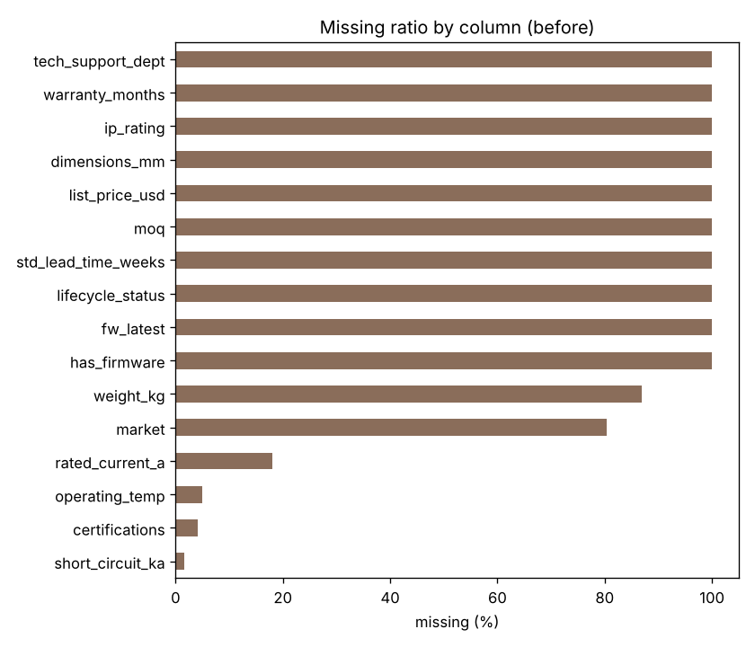
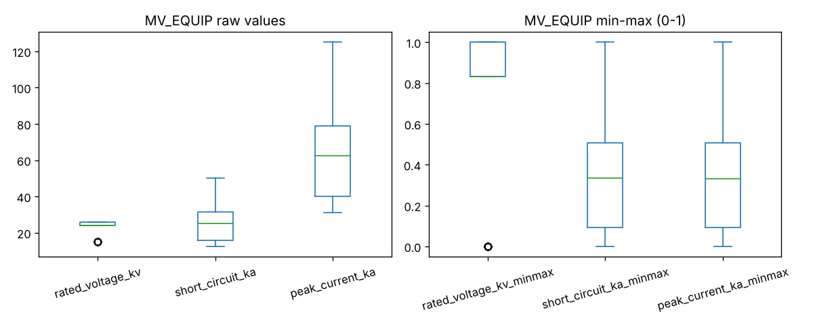

# 제품표 데이터 전처리 (결측치 처리·정규화)

에이전트가 판정 기준값으로 쓰는 제품표 `data/seed/products/product_master.csv`(122행 × 41열)의 상태를 점검하고, 분석용 정리본을 만든 기록입니다. Kaggle Learn의 Pandas, Data Cleaning 과정에서 배운 방법을 프로젝트 데이터에 적용했습니다.

- 노트북: [`product_master_cleaning.ipynb`](product_master_cleaning.ipynb) (실행 결과 포함)
- 결과: [`results/`](results/)
- 원본 제품표는 바꾸지 않았습니다. 에이전트의 판정은 지금처럼 원문 값과 원문 단위를 씁니다(CR-10). 여기서 만든 정규화 열은 분석과 시각화용입니다.

## 한 일

| 단계 | 내용 |
|---|---|
| 결측 현황 | 열별 결측률 계산. 전체 셀의 29.2%가 빈칸 |
| 결측 원인 분류 | ① 122행 모두 빈 열 10개(가격·납기·펌웨어 등, 공개 카탈로그에 없는 항목) ② 구조적 결측: SPD 20종은 정격 전류 대신 Imax로 사양을 표시해 `rated_current_a`가 원래 없음 ③ 수집 누락: 무게, 인증, 시장 등 |
| 결측 처리 | ①은 분석본에서 제외. ②③은 **채우지 않고** 이유 표시 열(`rated_current_status`, `*_missing`)을 붙임 |
| 깨진 글자 복구 | `operating_temp` 116칸의 `째C`를 `°C`로 복구 (UTF-8 `°`를 CP949로 잘못 읽어 생긴 문제) |
| 형식 통일 | 숫자 열 15개를 숫자형으로 변환(`125`/`125.0` 같은 표기 차이 제거), 온도 범위를 최솟값·최댓값 열로 분리, `;`로 이은 여러 값 칸 정리 |
| 일관성·이상치 점검 | 투입 전류 = 피크 전류, 피크 ≈ 2.5 × 단시간 전류(±1%) 규칙 점검 → 위반 0건. 제품군 안 IQR 이상치 후보 4건(4000 A UL VCB)은 실제 카탈로그 값이라 지우지 않고 표시만 함 |
| 정규화 | 정격 전압·전류·단락 전류·피크 전류를 제품군 안에서 Min-Max(0~1)와 Z-score로 바꾼 열을 추가 (원래 값 열은 유지) |

## 전후 비교

| 항목 | 전 | 후 |
|---|---:|---:|
| 열 수 | 41 | 31 (+ 표시·정규화 열 20) |
| 결측 셀 비율 | 29.2% | 6.3% |
| 이유를 알 수 없는 결측 셀 | 1,459 | 0 |
| 깨진 글자 칸 | 116 | 0 |
| 숫자형 열 | 0 | 15 |
| 숫자 표기 차이 | 2개 열 | 0 |

결측 비율이 줄어든 주된 이유는 값이 하나도 없던 10개 열을 뺐기 때문입니다. 남은 결측 239칸은 채우지 않았고, 모두 왜 비었는지 표시했습니다.




## 사양값을 채우지 않은 이유

무게나 정격 전류를 평균·중앙값으로 채우면 에이전트가 그 값을 근거로 적합·부적합을 판정할 수 있습니다. 같은 제품군 안에서도 무게가 195~440 kg로 크게 다르기 때문에, 추정값은 판정 근거를 지어내는 것과 같습니다. 그래서 결측은 그대로 두고 "해당 없음"과 "확인 필요"를 구분해 표시했습니다.

## 다시 실행하기

```bash
cd experiments/data_cleaning
pip install pandas numpy matplotlib jupyter
jupyter nbconvert --to notebook --execute --inplace product_master_cleaning.ipynb
```
